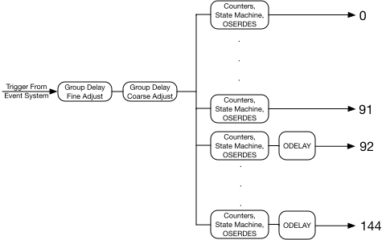

# Event Fanout, Receiver, and Kicker Driver — Firmware

> [!NOTE]
> **event-fanout-receiver docs:** [Overview](README.md) · [Firmware](Firmware.md)<br>
> **Related projects:** [EPICS support (siocEventClient) ↗](https://git.als.lbl.gov/alsu/epics/iocs/siocEventClient/-/blob/HEAD/documentation/EPICSnotes.md) · [dual-evg hardware ↗](https://gitlab.lbl.gov/alsu-instrumentation/dual-evg/-/blob/HEAD/documentation/Hardware.md)

## Contents

- [Images and Hardware Detection](#images-and-hardware-detection)
- [Marble Platform](#marble-platform)
  - [Front panel](#front-panel)
  - [Buttons](#buttons)
  - [LCD display](#lcd-display)
- [Event Fanout](#event-fanout)
- [Event Receiver](#event-receiver)
- [Kicker Driver](#kicker-driver)
- [Network Services](#network-services)
- [TFTP Server](#tftp-server)
- [Console Commands](#console-commands)
- [Building](#building)
- [Deploying](#deploying)
- [Scripts](#scripts)

---

## Images and Hardware Detection

Two firmware images are built from this repository:

| `APP` | Image | Modules |
|---|---|---|
| `evfr` | Event fanout/receiver | Event fanout and event receiver |
| `kd` | Kicker driver | Kicker driver |

The `evfr` image serves both the fanout and the receiver. At startup the firmware reads the FMC cards' IPMI EEPROMs and enables what it finds:

| Card | Slot | Enables |
|---|:---:|---|
| EVIO | FMC 1 | Event fanout (event stream from the first FireFly channel) |
| EVRIO or UserTiming (UTIO) | FMC 2 | Event receiver outputs |
| KDIO | either | Kicker driver (warns if the image isn't the `kd` image, and vice versa) |

The event stream comes from the EVIO card if present, otherwise from **QSFP2** on the Marble. The console warns if neither or both are present.

---

## Marble Platform

All modules are built on the same Marble FPGA platform as the dual event generator. See the [dual event generator hardware documentation](https://gitlab.lbl.gov/alsu-instrumentation/dual-evg/-/blob/HEAD/documentation/Hardware.md) for details.

### Front panel

| # | Component |
|---|---|
| 1 | RJ-45 1000Base-T Ethernet |
| 2 | USB console serial port and JTAG interface |
| 3 | **Display** button |
| 4 | **Reboot/Recovery** button |
| 5 | LCD display |

### Buttons

#### Display

| Action | Result |
|---|---|
| Press while the display is dark | Turns the backlight back on for another 20 minutes (it turns off after 20 minutes to extend its lifetime). |
| Press | Cycles to the next display page. |
| Hold, then press and hold **Reboot/Recovery** for > 2 s | Boots `EVCLIENT_B.bit` instead of the default `EVCLIENT_A.bit`. |

#### Reboot/Recovery

Pressing and holding this button for **more than two seconds** makes the FPGA reboot.

> [!TIP]
> **Recovery mode** — If this button is held down while the FPGA starts up, the firmware uses the default network settings for this boot:
>
> | Setting | Default |
> |---|---|
> | Ethernet MAC | `AA:4C:42:4E:4C:05` |
> | IPv4 address | `192.168.1.129/24` |
> | Gateway | `192.168.1.1` |
>
> The same defaults are used when the settings in flash are invalid.

### LCD display

Pressing **Display** cycles through three pages. The bottom line of every page shows the date and time, the heartbeat indicator, the flash write-protection state, and the IPv4 address.

| Page | Contents |
|---|---|
| Status | MAC address, MMC firmware version, Git hash, clock frequencies, temperatures, and supply voltages |
| Events | Event codes as they arrive; each stays on screen for about 0.7 s. Only events 1–111 fit on the display: correct arrival of events 112, 113, and 125 shows in the date and time, and of event 122 in the heartbeat indicator. |
| FireFly | FireFly transceiver status (event fanout) |

---

## Event Fanout

The event fanout uses the same EVIO FMC card as the event generator. It receives the event stream on the first channel of the first FireFly module and redistributes it through the EVIO crosspoint switch.

> [!NOTE]
> Building with `GW_VARIANT=USE_QSFP_FANOUT` also fans the event stream out through QSFP2. This is a test feature: its latency isn't fully deterministic and can vary by about one clock period.

---

## Event Receiver

The event receiver has **12 outputs**, each triggered by its own trigger bus line (output *N* by line *N* − 1). Each output can produce a single pulse with programmable delay and width, or a pattern.

| Outputs | Connector type | Pattern modes |
|---|---|:---:|
| 1–4 | Differential pattern outputs | ✓ |
| 5–12 | Single-ended trigger outputs | — |

Delays and widths are in RF buckets, up to 16,777,215 buckets (about 33.5 ms) each. In the pattern modes the delay is rounded down to a multiple of four buckets, because the pattern hardware works four buckets at a time. See [Event Receiver Outputs ↗](https://git.als.lbl.gov/alsu/epics/iocs/siocEventClient/-/blob/HEAD/documentation/EPICSnotes.md#event-receiver-outputs) for the EPICS records.

> [!NOTE]
> The driver circuit on the UTIO boards has a low-to-high propagation time almost 2 ns longer than its high-to-low propagation time. To get a pulse *N* buckets wide at the output connector, program a width of *N* + 1 buckets.

---

## Kicker Driver

The kicker driver uses a custom dual-FMC card (KDIO) and an SO-DIMM connector card to carry signals from the FPGA to the back-panel driver boards. It has **145 outputs**, numbered in this order:

| Outputs | Connector | Fine delay |
|---|---|---|
| 0–57 | FMC 2 | 800 ps |
| 58–91 | FMC 1 | 800 ps |
| 92–144 | SO-DIMM | 80 ps (ODELAY) |



The firmware blocks that generate the gate driver triggers:

1. An **IDELAY** block delays the event receiver's recovered clock by 0–800 ps in about 80 ps steps, producing the clock used by the gate driver blocks. It is common to both groups.
2. A **delay counter** per group, programmable in event receiver ticks (≈ 8 ns).
3. **Counters, a state machine, and the OSERDES** in each output's SelectIO block generate a pulse with a delay of up to 4095 ticks (just under 32.77 µs) and a width of up to about 32.78 µs, both in 800 ps steps. The delay and width counters are each 12 bits.
4. The SelectIO blocks of the SO-DIMM outputs include an **ODELAY** block, adding 0–800 ps in about 80 ps steps.

### Output polarity

Gate driver outputs are **active high**: they idle low and go high for the pulse. The polarity is set at build time by `CFG_KD_SERDES_POLARITY` in `software/target/kd_marble/config.h` (`"ACTIVE_HIGH"` or `"ACTIVE_LOW"`). While the gate driver clock is starting up or has lost lock, the output serializers are held in reset and their outputs are low, which is the idle level for active-high outputs.

### Two groups

There are **two groups** of timing settings. Group 0 is triggered by trigger bus line 0 and group 1 by line 1. Every output has a separate delay, width, and enable for each group, so one output can fire on either trigger with different timing. If both groups' pulses are active on an output at the same time, **group 0 takes priority**.

> [!WARNING]
> The clock IDELAY (step 1) is shared, but each group's delay setting writes it. The last group written sets the 80 ps part of the group delay for **both** groups. Only the 8 ns and 800 ps parts of the group delay are truly per group.

Conceptually this is simple, but the internal programming is complex — a one-bucket change in the overall delay changes the parameters of all 145 output state machines, the fine delay, and perhaps the coarse delay. The EPICS IOC hides this behind a few records per group; see [Kicker Driver Timing Control ↗](https://git.als.lbl.gov/alsu/epics/iocs/siocEventClient/-/blob/HEAD/documentation/EPICSnotes.md#kicker-driver-timing-control).

### Driver monitoring

The firmware can read the back-panel driver monitors over I²C and report outputs stuck low or high (protocol command group `0x6000`). The EPICS support module doesn't use this yet.

---

## Network Services

| UDP port | Service |
|--:|---|
| 69 | TFTP server |
| 50004 | Network console (`console.py` in siocEventClient) |
| 58765 | EPICS commands and readbacks |
| 58766 | Event monitor |

---

## TFTP Server

| Name | Flash location | Size | Description |
|---|---|--:|---|
| `EVCLIENT_A.bit` | 0 MiB | 7 MiB | Primary boot image |
| `EVCLIENT_B.bit` | 8 MiB | 7 MiB | Alternate boot image |
| `SystemParameters.bin` | — | — | Network settings, MGT clock offset, startup debug flags |
| `FullFlash.bin` | 0 MiB | 16 MiB | Entire flash |
| `FMC1_EEPROM.bin` | — | 256 B | IPMI EEPROM of the card in FMC 1 |
| `FMC2_EEPROM.bin` | — | 256 B | IPMI EEPROM of the card in FMC 2 |

Transfer files in binary mode.

---

## Console Commands

The FPGA sends startup and diagnostic messages to its USB serial console and to UDP port 50004.

- No command history; the only editing is backspace/delete.
- Carriage return or line feed ends a line. Arguments are separated by spaces or commas.
- Commands are case-insensitive and may be shortened to any **unique** prefix: `b` for `boot`, but `de` for `debug` and `du` for `dumpscreen`. An ambiguous prefix prints *Not unique*.
- `help` or `?` lists the commands.

| Command | Description |
|---|---|
| `boot [-b]` | Reboot the FPGA from `EVCLIENT_A.bit`, or `EVCLIENT_B.bit` with `-b`. Asks for confirmation. |
| `crosspoint` | Show the EVIO crosspoint switch registers. |
| `debug [-s] [-h] [flags]` | Show or set the debug flags (hex). `-s` also saves them in flash as the startup value; `-h` lists the flags. |
| `dumpscreen` | Dump the LCD to the console (see `scripts/dumpScreen.py`). |
| `eyescan [-n\|-r]` | Eye diagram of the event link receiver. See below. |
| `fmon` | Show FPGA clock frequencies. |
| `log` | Replay the startup messages. |
| `mac [aa:bb:cc:dd:ee:ff]` | Show the MAC address, or set it in flash (with confirmation). |
| `net [www.xxx.yyy.zzz[/n]]` | Show the network settings, or set them in flash (with confirmation). The netmask comes from the prefix length `/n`, default 24. |
| `reg r [n]` | Show `n` (default 1) GPIO registers starting at `r`. |
| `showEVIO` | Continuously show the EVIO trigger, diagnostic, and auxiliary inputs until a key is pressed. |
| `tlog` | Log timing system events until a key is pressed. |
| `userMGT [ppm]` | Show or set the event link receiver clock offset, ±3500 ppm. Saved in flash. See below. |

### Debug flags

| Mask | Effect |
|---|---|
| `0x1` | EPICS UDP port messages |
| `0x2` | Event monitor UDP port messages |
| `0x4` | TFTP server messages |
| `0x8` | Boot flash I/O messages |
| `0x10` | Show kicker gate driver settings as they are updated (kicker driver only) |
| `0x20` | Show MGT resets that synchronize the receiver with the incoming event stream |
| `0x40` | Show the receive aligner state |
| `0x800` | Processor I²C operations |
| `0x1000` | EVIO (FMC 1) I²C transactions |
| `0x2000` | EVIO (FMC 1) register-level I/O |
| `0x4000` | EVRIO (FMC 2) I²C transactions |
| `0x8000` | EVRIO (FMC 2) register-level I/O |
| `0x10000` | Scan the processor I²C buses and report responding devices; show QSFP status if present |
| `0x20000` | Simulate a press and release of the **Display** button (self-clearing) |
| `0x40000` | Show events as they arrive from the timing system |
| `0x80000` | Si570 setting messages |
| `0x1000000` | MGT clock switch register I/O |
| `0x2000000` | Dump the MGT clock switch registers |
| `0x4000000` | Dump the LCD contents to the console |

### `eyescan`

Shows the eye diagram of the event link receiver. A full scan takes several seconds; EPICS communication and event reception continue meanwhile.

| Option | Effect |
|---|---|
| `-n` | Show hex digits — the floor of log₂(error count) at each point — instead of ASCII art. Zero-error points still show as space, overflows as `@`. |
| `-r` | Print the error count at each point. |

### `userMGT`

The receiver's clock/data recovery locks only within a limited range, so the receiver reference clock (a Si570, nominally 100 MHz) can be offset:

| Offset | Use |
|--:|---|
| 0 ppm | 100.00 MHz user clock — 2.500 Gb/s event link, 125.00 MHz event generator clock |
| −700 ppm | ALS, or the ALS-U injector and booster ring event system |
| +700 ppm | ALS-U accumulator and storage ring event system |

---

## Building

Requires GNU Make and Vivado/Vitis **2020.2.2** (`vivado` and `vitis` on `PATH`). Fetch the submodules first:

```sh
git submodule update --init
make CROSS_COMPILE=<vitis>/gnu/microblaze/lin/bin/mb- APP=evfr PLATFORM=marble
```

| Variable | Values |
|---|---|
| `APP` | `evfr` (default), `kd` |
| `PLATFORM` | `marble` |
| `GW_VARIANT` | `USE_QSFP_FANOUT` — test feature, see [Event Fanout](#event-fanout) |

The bootable image is written to:

```
software/app/<APP>/<APP>_marble.<git-hash>.bit
```

---

## Deploying

### Over JTAG (development)

```sh
cd scripts
./deploy.sh ../software/app/<APP>/<APP>_marble.<git-hash>.bit
```

This loads the FPGA with OpenOCD (`scripts/marble.cfg`); nothing is written to flash.

### To flash

```sh
software/scripts/programFlash.sh <ip-address> [A|B] <image.bit>
```

The script uploads the image by TFTP to `EVCLIENT_A.bit` (default) or `EVCLIENT_B.bit`, reads it back, and compares. Look for **Flash write succeeded.** Write and test the B image first (`boot -b`), then write A.

---

## Scripts

| Script | Purpose |
|---|---|
| `scripts/deploy.sh` | Load an image over JTAG with OpenOCD |
| `scripts/dumpScreen.py` | Capture the LCD as an image, over the serial console or the network (`-d`, `-f` filename) |
| `software/scripts/programFlash.sh` | Write a boot image to flash over TFTP and verify it. Arguments in any order: address (default `$FPGA_IP_ADDRESS` or `192.168.2.12`), `A` or `B`, and the `.bit` file. |
| `software/scripts/programEEPROM.sh` | Write an IPMI EEPROM image to `FMC1_EEPROM.bin` or `FMC2_EEPROM.bin` over TFTP and verify it |
| `software/scripts/create_FMC_EEPROM.sh` | Create FMC IPMI EEPROM images |
| `software/scripts/pushImage.sh` | Copy images to the EPICS file server. The user, host, and file names are hard-coded. |

The EPICS-side scripts (`console.py`, `kickerDriverCheck.py`, `allOnOff.py`) are in the [siocEventClient](https://git.als.lbl.gov/alsu/epics/iocs/siocEventClient) repository.
